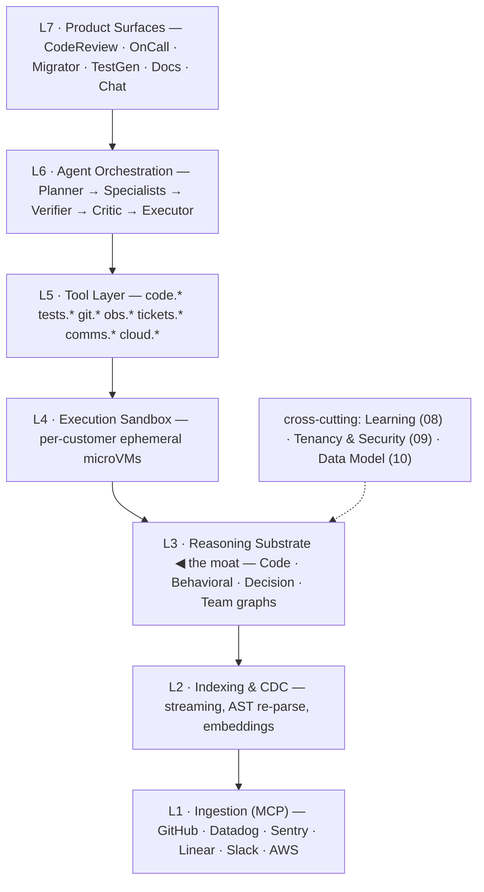
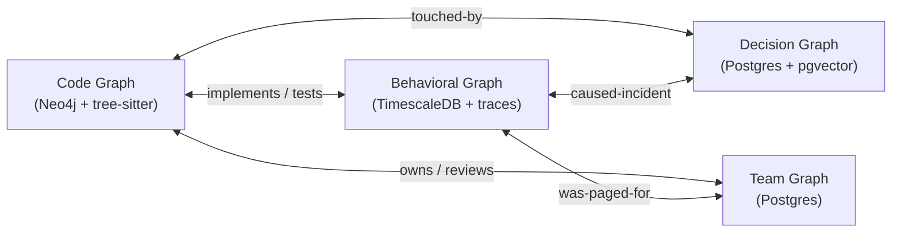
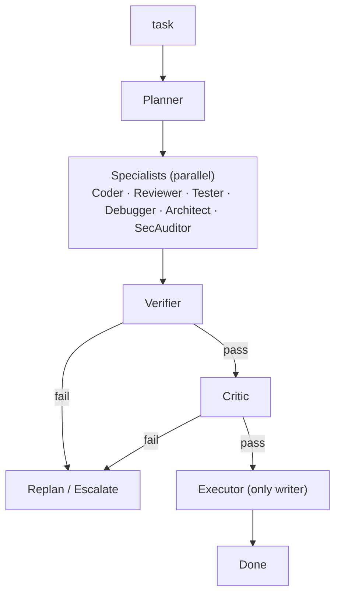
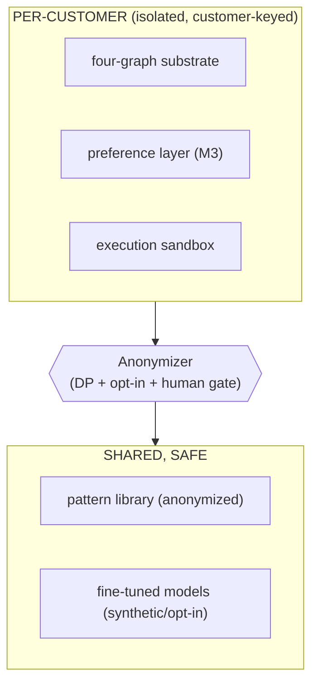

# Shared diagrams

Canonical mermaid versions of the diagrams the architecture docs reference. Keep these the source
of truth; the inline ASCII in each doc is a convenience copy.

## The 7-layer stack (+ cross-cutting concerns)

## The four-graph substrate (L3)

## The agent role flow (L6)

## The tenancy wall (09)

